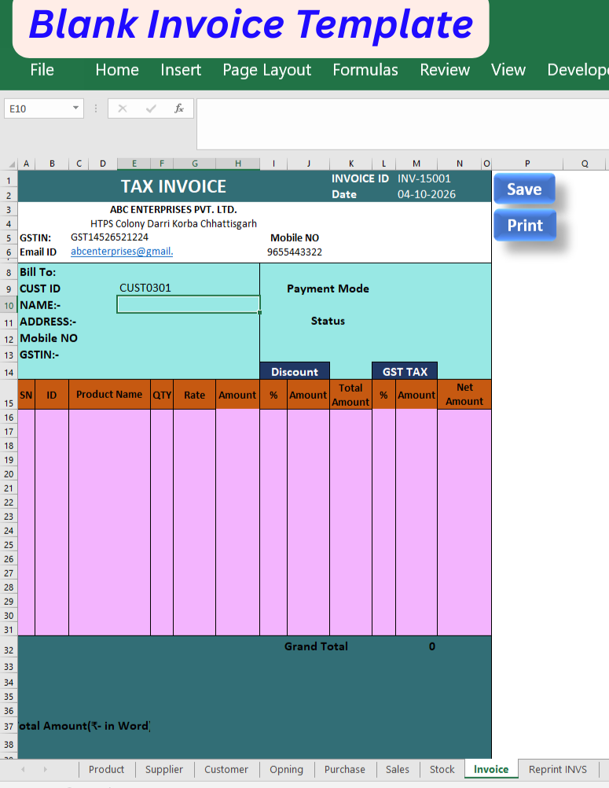
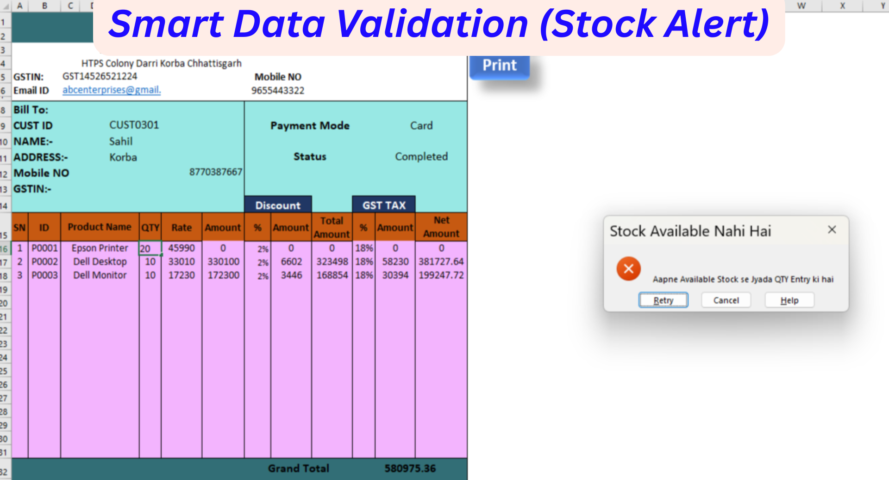
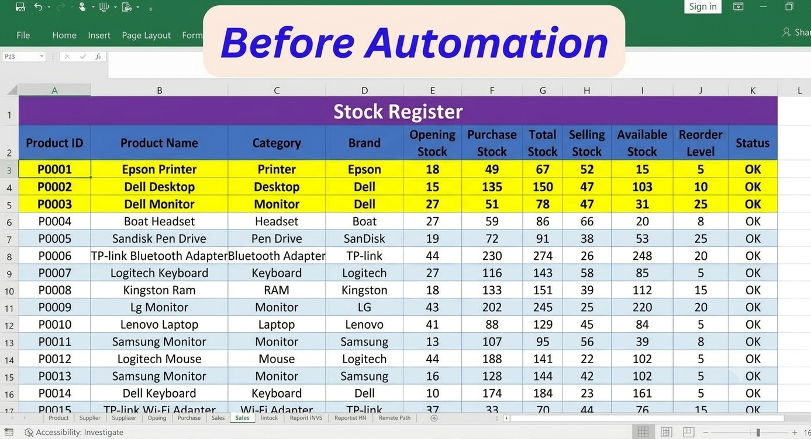
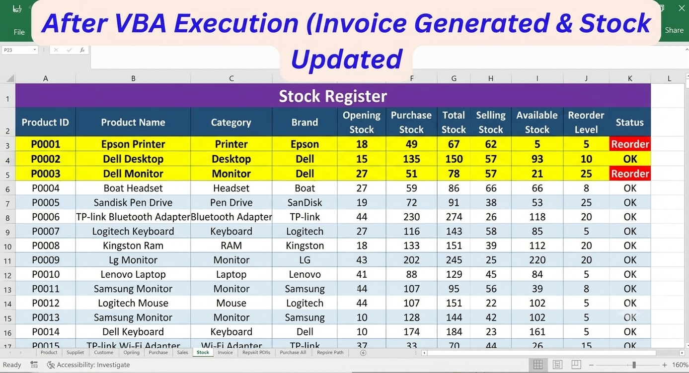
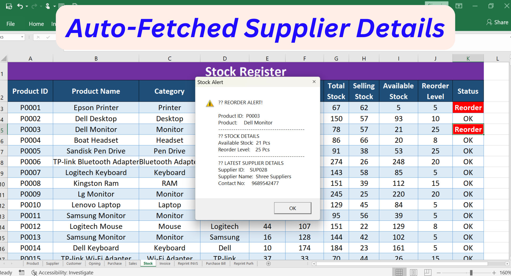
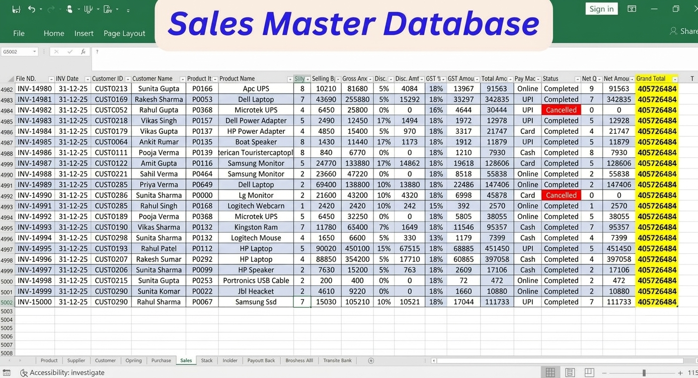
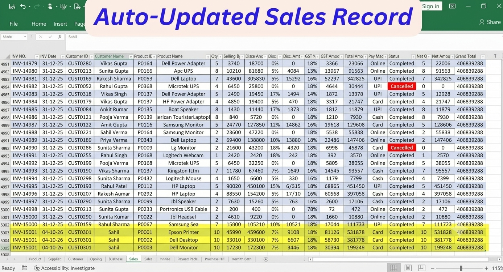

# 📦 Fully-Automated-Inventory-And-Billing-ERP-System

An automated **Excel-based Inventory & Billing Management System** designed for electronics retail and office-supplies businesses.

This project automates daily business operations such as **billing, inventory management, purchase and sales tracking, returns, stock validation, reorder alerts, invoice search, and purchase bill retrieval** using Microsoft Excel and VBA.

---

# 🚀 Key Features

- 🧾 Automated Sales Invoice Generation
- 🛒 Multi-Product Billing
- 📦 Automated Stock Management
- ⚠️ Low Stock / Reorder Alert
- 🚫 Stock Validation to prevent over-selling
- 🛍️ Automated Purchase Management
- 🔄 Sales Return Automation
- 🔄 Purchase Return Automation
- ❌ Cancelled Transaction Handling
- 🔎 Invoice Search & Retrieval
- 🧾 Purchase Bill Search & Retrieval
- 🖨️ Invoice & Purchase Bill Printing
- 👥 Customer & Supplier Management
- 🔢 Automatic Invoice Number Generation
- 💰 Automatic GST & Grand Total Calculation
- 📝 Amount in Words
- 📊 Ready for MIS / Power BI Dashboard Integration

  # 💡 How It Works (The Data Flow):
Create a bill in the 'Tax Invoice' or 'Purchase Entry' form.
Click 'Save' -> Data is instantly dispatched to 4 different database sheets.
The Master Stock adjusts automatically.
Old bills can be fetched anytime using the 'Search Bill' function.

# 🖼️Project File Download 

## Fully Automated Inventory & Billing ERP System
"Download the complete working Excel file to experience the automated workflow firsthand. This system is designed to handle 5000+ entries seamlessly, featuring 1-click invoice generation, dynamic stock tracking, and automated data entry."

## 📥 Download Project File

- [Fully Automated Inventory & Billing ERP System](./Automated_Invoice.xlsm)
  

# 🖼️ Project Screenshots & Automation Workflow

## Blank Invoice Template

The project starts with a clean and user-friendly invoice template designed for automated billing.

## Smart Data Validation — Stock Alert

The system validates the entered quantity against available stock. If the requested quantity exceeds available stock, an alert message is displayed to prevent an invalid sale.

---
## Before Automation — Stock Register

This screenshot shows the stock register before the invoice transaction is processed. The highlighted products currently have OK stock status.

---
## After VBA Execution — Invoice Generated & Stock Updated

After the invoice is generated and saved through VBA automation, the stock register is automatically updated. The available stock decreases and the affected products move to REORDER status when the reorder level is reached.

---
## Auto-Fetched Supplier Details

When a product reaches the reorder level, the system automatically identifies the affected product and fetches the corresponding supplier details, helping the user quickly contact the supplier for restocking.

---
## Sales Master Database

The Sales Master database stores transaction records generated by the billing system. The highlighted Grand Total demonstrates the automatically calculated sales value.

---
## Auto-Updated Sales Records

After completing a multi-product invoice, the Sales Master database is automatically updated with the corresponding sales records. Multiple products from the same invoice are stored as separate transaction rows.

---

# 🔄 Automation Flow

Invoice Entry → Smart Stock Validation → VBA Execution → Invoice Generation → Automatic Stock Update → Reorder Detection → Supplier Details → Sales Database Update

This workflow demonstrates how the Excel system connects billing, inventory management, validation, reorder management, and sales data recording into a single automated process.

## 🛠️ Tools & Technologies

- Microsoft Excel
- Excel Formulas
- VBA Automation
- Data Validation
- Conditional Formatting
- Excel Tables
- Inventory Management
- Billing Automation
- Stock Management

# 📞 Connect With Me

If you are interested in Excel Automation, Inventory Management, Billing Systems, MIS Reporting, or Power BI Dashboards, feel free to connect with me.

- 💬 WhatsApp: [Chat on WhatsApp](https://wa.me/+918770387666)
- 📧 Email: [Send Me an Email](mailto:prdeepkurrey03@gmail.com)
- 📸 Instagram: [Follow Me on Instagram](https://instagram.com/kurrey387)
- 💻 GitHub: [Visit My GitHub](https://github.com/pradeepkurrey)
- 🌐 **Portfolio:** [My Portfolio](https://pradeepkurrey.github.io/My-Website/)
- 💼 **LinkedIn:** [My LinkedIn Profile](https:lnkd.in/p/d9E3E49N)

---

# 👨‍💻 About Me

## Pradeep Kumar Kurrey
Advanced Excel & MIS Executive

## Specialized in:
"Excel Automation" • "VBA" • "MIS Reporting" • "Power BI" • "Data Cleaning" • "Inventory & Billing Automation"

    
